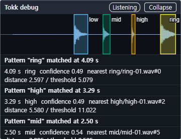

# Tokk

Tokk is a sound-event engine that lets an app react to short sounds like a clap, a knock or a whistle, in the browser and in Node. It is made of a pure TypeScript core (segmenter, features, k-nearest-neighbour classifier, pattern matcher), a browser layer (microphone, AudioWorklet, Worker, teach dialog, debug overlay), a Node layer (teaching from WAV files, `expectEvents`), an MCP server, and a Kiro power with two agents. It has no runtime dependencies.

## 1. Current status

This section says what works and what has not been checked.

What works in this repository:

- The core engine, the browser layer, the Node tools and the MCP server run from source. `npm test` runs the unit and property tests.
- Two apps (Hands-Free, Knock Once for Yes) and a third case (a reveal.js slide deck) use Tokk through the public API only.
- `teach.html` records a sound 10 times and writes WAV files and a `sounds.json` of feature vectors.

What has not been checked:

- All recognition tests use **synthetic sounds** (made by `core/synth`) and Chrome's fake microphone. They show the logic and the wiring, not how well Tokk hears a real mouth, hand or table.
- The real-microphone checks are pending. Teaching time, wrong clicks and accuracy of real sounds are not measured yet (see section 5.2).
- The demo video is pending.
- The GitHub Pages site is not deployed yet. It will be at https://subniin.github.io/tokk/.
- The npm package `tokk` is not published yet. Everything that needs the package (the CDN import map, `npx tokk-mcp`) works after publish.

## 2. Teach your sounds

### 2.1 The teach screen

The picture shows the debug overlay (`debug: true`) while the hello example hears synthetic sounds: the four sounds `low`, `mid`, `high` and `ring`, the matched patterns, the confidence and the distance to the nearest taught example. A GIF of the teach dialog replaces it later.



### 2.2 Teach steps

`teach.html` is part of this repository and is not in the npm package.

1. Run `npm run dev`.
2. Open `http://localhost:5173/teach.html`.
3. Pick the project folder.
4. Type the sound name.
5. Record the sound 10 times.
6. Save.

The result is the same as running `npm run sounds:rebuild`: WAV files in `sounds/<name>/` and a `sounds.json` with feature vectors.

## 3. Hello example

### 3.1 The code

7 lines of Tokk code listen to the microphone and write every recognised sound and pattern as text. The page is `examples/hello/index.html`.

The code imports `tokk` the way an app does. A browser needs an import map to find it, and the map is the one extra line. It is not counted:

```html
<script type="importmap">{ "imports": { "tokk": "https://cdn.jsdelivr.net/npm/tokk/+esm" } }</script>
```

```js
// tokk:start
import { listen, loadSounds } from 'tokk';
const show = (m) => results.append(Object.assign(document.createElement('li'), { textContent: `${m.pattern} at ${m.t.toFixed(2)} s` }));
const on = Object.fromEntries(['low', 'mid', 'high', 'ring', 'low _ mid'].map((pattern) => [pattern, show]));
start.onclick = async () => {
  try { await listen({ sounds: await loadSounds('sounds.json'), on, debug: true }); }
  catch (e) { error.textContent = e.message; }
};
// tokk:end
```

The CDN map works after publish. The page in this repository maps `tokk` to the local build instead (`../../dist/tokk.js`). The example needs a browser with import maps.

The model in `examples/hello/sounds.json` is synthetic: it was built from synthetic sounds at the sample rate of the test microphone, so your own sounds will not match it. Replace it by teaching real sounds with `teach.html` and picking `examples/hello` as the project folder.

### 3.2 Run it

1. Install Node 20 or newer and Chrome.
2. Clone the repository and install the packages.
3. Start the dev server.
4. Open `http://localhost:5173/examples/hello/index.html`, press **Start listening** and allow the microphone.

```
git clone https://github.com/subniin/tokk.git
cd tokk
npm install
npm run dev
```

### 3.3 Errors and a keyboard fallback

`onError` tells the app when listening ends (the microphone was unplugged, the Worker failed, the audio context closed). The `Ears` is then finished, so the app calls `listen()` again, for example from a Reconnect button. `source: 'keys'` runs without a microphone: `ears.inject(label)` feeds a sound into the same pattern rules, so a key press and a real sound behave alike.

```ts
const ears = await listen({
  sounds,
  on,
  onError: (error) => showReconnectCard(error.kind, error.message),   // 'mic-ended' | 'worker' | 'audio-closed'
});

// No microphone (permission denied, no device): the same patterns, driven by keys.
const keys = await listen({ sounds, on, source: 'keys' });
addEventListener('keydown', (e) => { if (e.key === ' ') keys.inject('clap'); });
```

Teach option: `ears.teach('background', { ui: true, backgroundMs: 30000 })` shows a countdown, hides **Done** and ends the recording by itself after 10000 to 120000 ms; other labels ignore it.

## 4. Demo video

Demo video: coming with the submission.

## 5. Two apps and a third case

### 5.1 The cases

| Case | Screenshot | Sounds | Wiring lines | Time | Kiro credits |
|---|---|---|---|---|---|
| [Hands-Free](apps/hands-free/) (browse a page with mouth sounds) | [png](docs/images/hands-free.png) | tongue click, hum, `background` | 17 | 1 h 24 min | about 135 |
| [Knock Once for Yes](apps/knock-once/) (answer a ghost by knocking) | [png](docs/images/knock-once.png) | knock | 19 | 1 h 57 min | about 84 |
| [Slide deck](cases/slides/) (reveal.js, clap twice for the next slide) | [png](docs/images/slides.png) | clap (synthetic claps for the Node tests; the user teaches real claps on the first run) | 17 | 1 h 50 min | about 42.7 |

Conditions, from [docs/integration.md](docs/integration.md):

- Time is Kiro wall-clock time, from the Kiro run that wrote the spec to the commit whose tests met the completion criteria. There was no manual coding.
- For the slide deck, the time is stage 2 only: sound control added to an existing reveal.js deck. The baseline deck is not counted.
- Credits are the Kiro credits of those runs. The times do not include any check with a real microphone.
- Wiring lines are the lines between `// tokk:start` and `// tokk:end`, counted by `npm run count:wiring`.

### 5.2 Measured numbers

| Group | Wiring lines | Conditions and source |
|---|---|---|
| `apps/hands-free` | 17 | `npm run count:wiring`, same as docs/integration.md |
| `apps/knock-once` | 19 | `npm run count:wiring`, same as docs/integration.md |
| `cases/slides` | 17 | `npm run count:wiring`. The agent wrote 12 non-blank lines, the caption added the rest |
| `examples/hello` | 7 | `npm run count:wiring` |

Not measured yet, because each needs a real microphone and a person: the time to teach a new sound, three articles read hands-free, wrong clicks while talking, a whole game by knocking, one knock against two knocks, and the double clap in the deck. The method and the target of each check are in [docs/integration.md](docs/integration.md).

### 5.3 Credit

The slide deck uses [reveal.js](https://revealjs.com) by Hakim El Hattab, version 6.0.2, under the MIT licence. The licence text is in `cases/slides/LICENSE-revealjs.txt` and is copied byte for byte from the package. The case calls only the public API of reveal.js and never edits it. No reveal.js logo is used. Details are in [cases/slides/README.md](cases/slides/README.md).

## 6. How it works

### 6.1 The flow

The microphone feeds an AudioWorklet. The worklet sends sample blocks to a Worker, so the page thread stays free. The Worker runs the pipeline:

```
microphone -> AudioWorklet -> Worker -> segmenter -> features -> kNN -> matcher -> on[pattern](match)
```

1. The **segmenter** follows the level, calibrates on the first 1000 ms and cuts one segment per sound.
2. The **features** step turns a segment into a vector of numbers.
3. The **kNN** classifier compares the vector with the taught examples. A sound that is too far from every example is `unknown`.
4. The **matcher** reads the sound names and gaps against the patterns of the current mode.

Every time is a cumulative sample count divided by the sample rate, in seconds. `m.t` in a match is such a time.

### 6.2 The pattern rule

A pattern is sound names separated by a space (`clap clap`). `_` is a rest, and `hum.rise` and `hum.fall` are a rising and a falling hum. A gap shorter than 350 ms joins two sounds. A rest is 350 to 1000 ms.

The matcher waits while a longer pattern can still extend the match, and otherwise fires at once. With the patterns `clap clap` and `clap clap clap` in one set, `clap clap` fires about a third of a second after the second clap, because a third clap could still follow. `modes` give an app separate pattern sets for separate screens.

## 7. Repository layout

### 7.1 The tree

```
core/             # pure TypeScript: segmenter, features, classifier, grammar, engine, synth
web/              # browser: microphone, AudioWorklet, Worker, listen(), teach dialog, overlay
node/             # Node: teachFromDir, expectEvents, scoring, WAV files
tools/mcp-ears/   # MCP server with the tools teach, listen, score, spectrogram
apps/             # Hands-Free and Knock Once for Yes, one folder per app
cases/            # the slide deck case (reveal.js with sound control)
examples/         # the hello example and its synthetic model
.kiro/            # specs, steering, hooks, agents, MCP settings
powers/tokk/      # the Kiro power: skills integrate, tune-sounds, new-app
scripts/          # build, build:site, count:wiring, check:public-api, score
test/             # Vitest tests and Playwright browser tests
docs/             # integration.md, kiro.md, devlog, experiments, images
teach.html        # the teach page (not in the npm package)
```

### 7.2 What each layer may import

- `core/` imports only from `core/`. It uses no `fs`, no `path`, no DOM and no Web Audio.
- `web/` imports from `core/` and `web/`. It may use browser APIs. It never imports `node/`.
- `node/` imports from `core/` and `node/`. It may use `fs`. It never uses browser APIs.
- `tools/mcp-ears/` imports from `core/` and `node/`.
- `apps/` and `cases/` import from `'tokk'` only. `npm run check:public-api` fails on a path into `core/`, `web/`, `node/` or `tools/`.

### 7.3 Set up and check

1. Install the packages with `npm install`.
2. Run the unit and property tests.
3. Run the three type checks and the public-API check.
4. Build the package and the static site.

```
npm test
npx tsc -p tsconfig.json --noEmit
npx tsc -p tsconfig.web.json --noEmit
npx tsc -p tsconfig.test-web.json --noEmit
npm run check:public-api
npm run build
npm run build:site
```

Run the property tests with more cases by setting `PBT_RUNS`:

```
# Windows PowerShell
$env:PBT_RUNS = 1000; npm test
```

```
# bash
PBT_RUNS=1000 npm test
```

The browser tests need Chromium once (`npx playwright install chromium`) and then `npm run test:web`.

## 8. Make a new app from this template

1. Press **Use this template** on GitHub. The repository is meant to be a template. The template setting is pending until the repository is pushed.
2. Open the new repository in Kiro. Keep `.kiro/` and `powers/tokk/`.
3. Install the power: open the Powers panel, choose Add Custom Power, then Import from folder (`powers/tokk`).
4. Teach the sounds with `teach.html`, or give a folder of WAV files of each sound.
5. Copy `.kiro/specs/_new-app/` to a new spec folder. Fill one table: sound name, example folder, pattern, action. Ask Kiro to write the requirements, the design and the tasks from it.
6. Let the `integrator` agent wire the sounds, or follow the `integrate` skill by hand. The agent runs only `npm test` and `npx vitest` in the shell.
7. Write the pattern table as a TypeScript object. It is the `on` table that `listen` takes:

```ts
const on = {
  'clap clap': () => deck.next(),
  'clap clap clap': () => deck.prev(),
};
```

8. Write one `expectEvents` test per pattern. Pass `patterns` (the pattern set of the app) and `matches` (what must fire), so the test shows that the pattern fires and not only that the sounds were heard.

```ts
await expectEvents('recordings/clap-x2.wav', ['clap', 'clap'], {
  sounds,
  patterns: ['clap clap', 'clap clap clap'],
  matches: ['clap clap'],
});
```

## 9. Node tools and MCP server

`tokk/node` has `teachFromDir`, which teaches from a folder of WAV files, and `expectEvents`, which tests a recording:

```ts
import { expectEvents } from 'tokk/node';

await expectEvents('clap-2.wav', ['clap', 'clap'], { sounds });

// Also check the patterns: the recording runs through the engine with exactly this set.
await expectEvents('clap-2.wav', ['clap', 'clap'], { sounds, patterns: ['clap clap', 'clap clap clap'], matches: ['clap clap'] });
```

The MCP server has four tools: `teach`, `listen`, `score` and `spectrogram`. In this repository, run it with `npm run mcp`. `.kiro/settings/mcp.json` starts it for Kiro. After publish, `npx tokk-mcp` starts it from the package, and the power uses that command.

## 10. Kiro

Kiro wrote the apps and the third case from specs. The repository uses these Kiro features:

- **Specs**: one folder per task in `.kiro/specs/`, with requirements, design and tasks. `_new-app` is the template for another project.
- **Steering**: layer, privacy, unit, UI and Web Audio rules in `.kiro/steering/`.
- **Hooks**: five hooks in `.kiro/hooks/` (score the corpus, quick property tests, public-API check, sounds rebuild, browser smoke test).
- **Agents**: `sound-tuner` and `integrator` in `.kiro/agents/`.
- **Power**: `powers/tokk` with the skills `integrate`, `tune-sounds` and `new-app`. Its MCP part works after publish.

The full list, the agent runs and the documentation pages checked are in [docs/kiro.md](docs/kiro.md).

## 11. Third-party components and licences

Tokk has no runtime dependencies. Every package below is a `devDependency` in `package.json`. The versions are the ones in `package.json`, and the licences are the ones the installed packages declare.

| Component | Version | Licence | Used for |
|---|---|---|---|
| `typescript` | 7.0.2 | Apache-2.0 | Language and type checks |
| `esbuild` | 0.28.2 | MIT | Build of the package, the apps and the Worker |
| `tsx` | 4.23.15 | MIT | Runs the scripts |
| `vitest` | 5.1.1 | MIT | Tests |
| `fast-check` | 4.10.3 | MIT | Property tests |
| `@fast-check/vitest` | 0.5.0 | MIT | Property tests in Vitest |
| `@playwright/test` | 1.65.0 | Apache-2.0 | Browser tests |
| `@types/node` | 26.6.6 | MIT | Node types |
| `@modelcontextprotocol/sdk` | 1.32.2 | MIT | MCP server, bundled into `dist/mcp.js` |
| `zod` | 4.6.7 | MIT | MCP tool schemas, bundled into `dist/mcp.js` |
| `reveal.js` | 6.0.2 | MIT | The slide deck case, bundled into the site |

The recordings and sounds in tests and examples are synthetic and made by `core/synth`. There are no third-party recordings. No third-party logo is used.

## 12. Privacy

Audio never leaves the device. No code sends audio over the network. `sounds.json` holds feature vectors only. Original recordings stay in local `sounds/` folders.

## 13. What is next

- An embedding classifier (a pretrained audio model) as a second classifier next to kNN.
- A Chrome extension, so a sound can control any page.
- `npm create tokk`, to start a new app without the GitHub template.

## 14. Known limits and common problems

### 14.1 Limits

- The first 1000 ms after the microphone opens is the **calibration window**. A sound inside it is lost, so stay quiet for one second.
- A sound that repeats soon after the previous one can come out as `unknown`.
- A pattern that is a prefix of a longer one fires late, by about a third of a second.
- A model is built at one sample rate. The hello model is synthetic and does not match your microphone.
- Tokk is tested on synthetic sounds and on Chrome's fake microphone. Experiments with real microphones are pending.

### 14.2 Common problems

- The microphone does not open. The browser allows it only on `localhost` or over HTTPS, and only after a user gesture. Start `listen()` from a click or a key press.
- The browser reports that it cannot resolve the module specifier `tokk`. The page has no import map. Add the map from section 3.1, or map `tokk` to `dist/tokk.js`.
- The import map is ignored. Put it before the first module script, and use a browser with import maps.
- Nothing is recognised. Teach the sounds again on the same microphone, with the room as quiet as when you use the app. Open the debug overlay with `debug: true` to see the distance and the threshold.
- Windows audio enhancements can change a sound before the browser hears it. Turn them off for the microphone while you teach.

## 15. Licence

MIT, see `LICENSE`.
